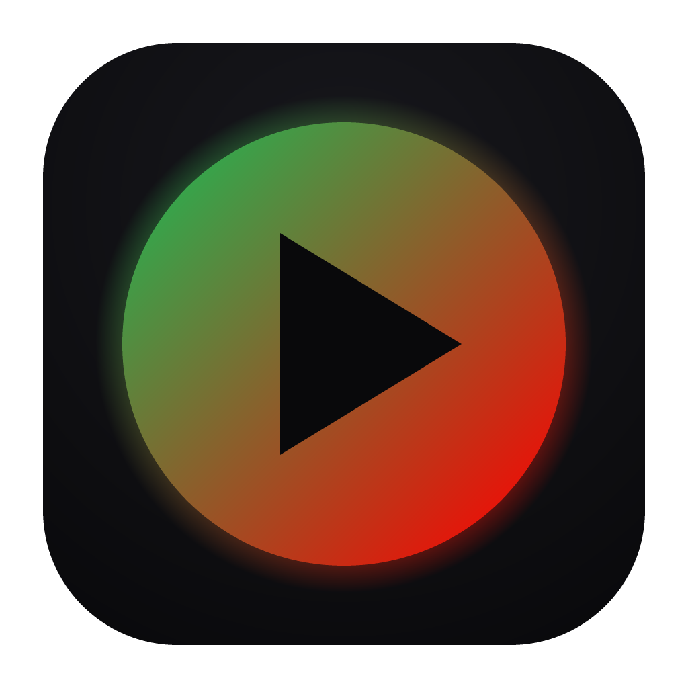
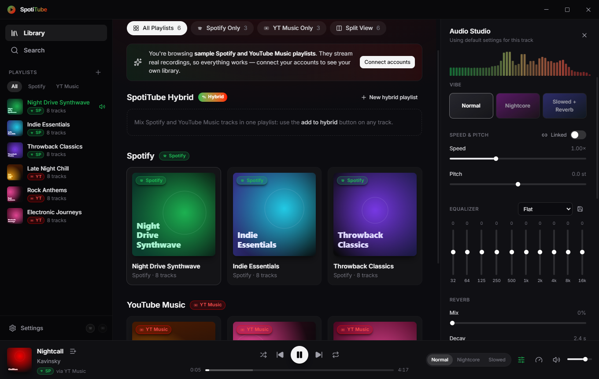
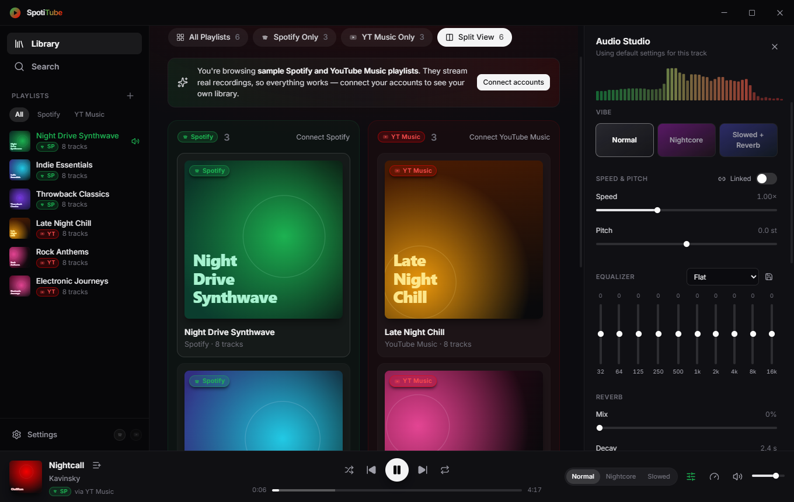
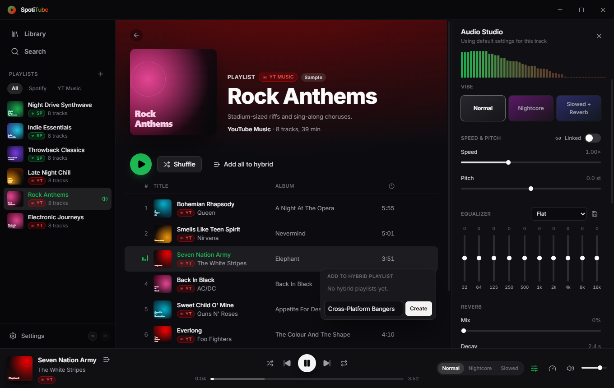
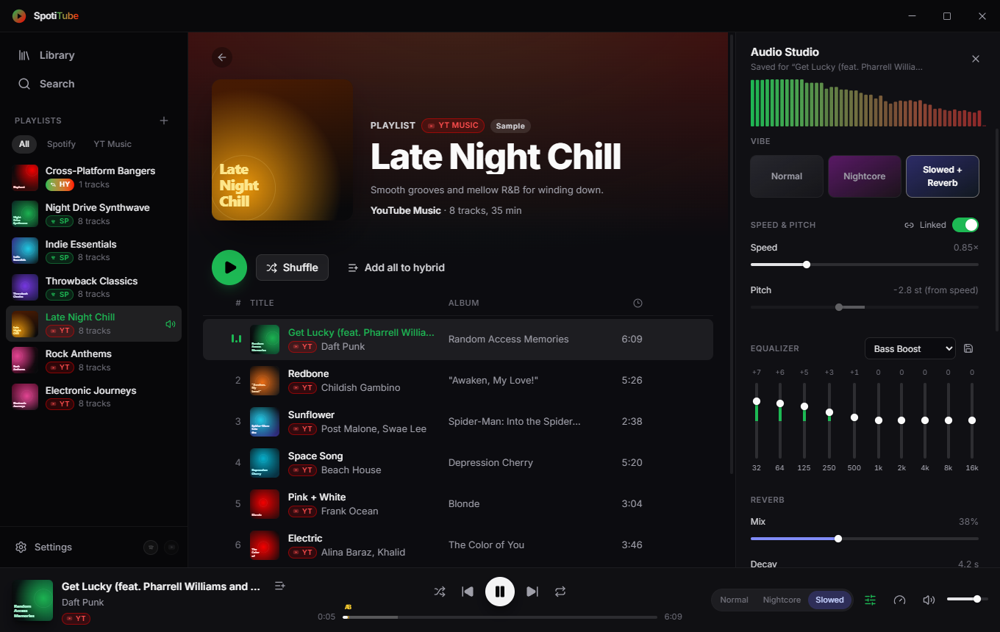

  

<h1 align="center">SpotiTube</h1>

  <b>Your Spotify and YouTube Music libraries in one desktop player — with a real-time audio studio built in.</b>

  
  
  

  <a href="https://github.com/Roguu2/SpotiTube-releases/releases/latest"><b>⬇ Download for Windows</b></a>
  &nbsp;·&nbsp;
  <a href="https://github.com/Roguu2/SpotiTube-releases/releases/latest"><b>⬇ Download for macOS</b></a>

  

---

## Stop switching apps

Your playlists live in two places. SpotiTube puts them in **one window**: every playlist and every track carries a
colour-coded badge, so you always know where it came from.

<table>
  <tr>
    <td width="50%" valign="top">
      <h3>One library, two services</h3>
      Spotify and YouTube Music playlists side by side. Filter by source, or open <b>Split View</b> to browse both
      catalogs in parallel columns.
    </td>
    <td width="50%" valign="top">
      <h3>Hybrid playlists</h3>
      Mix tracks from Spotify and YouTube Music in a single playlist. Add any track with one click, from any
      playlist or search result.
    </td>
  </tr>
  <tr>
    <td width="50%" valign="top">
      <h3>Search both at once</h3>
      One search box, results from both catalogs next to each other.
    </td>
    <td width="50%" valign="top">
      <h3>Pick the version you want</h3>
      Studio cut, live, remix, slowed, acoustic: swap the version of any track and SpotiTube remembers your
      choice.
    </td>
  </tr>
</table>

| Split View | Hybrid playlists |
| --- | --- |
|  |  |

## Make it sound the way you like

The **Audio Studio** is a real-time effects rack for whatever is playing:

- **Nightcore** and **Slowed + Reverb** in one click
- **Speed** from 0.5× to 2× — keep the pitch, or let it follow like a turntable
- **Pitch shift** of ±12 semitones, independent of speed
- **10-band equalizer** with presets (Bass Boost, Vocal, Electronic, …) and your own
- **Reverb** with adjustable size, pre-delay and damping
- **A-B loop** to repeat any part of a song — great for practising
- **Per-track memory**: every track remembers its own EQ, speed, pitch and loop

  

> **Good to know:** effects need direct access to the audio stream. YouTube currently limits that for apps, so
> tracks often play through **YouTube's official player** instead (shown in a small window). Speed, A-B loops and
> version picking still work there. EQ, pitch and reverb switch back on automatically whenever a direct stream is
> available, and your settings are kept until then.

## Feels like a native app

- Frameless, dark window designed for OLED screens, with a glow that follows the album art
- Media keys, system media controls and a tray menu
- Keyboard shortcuts for everything: `Space`, `←` `→`, `Ctrl+F`, `Ctrl+E`, …
- **Updates itself**: new versions download in the background and install with one click

## Get started in a minute

1. **Download** the installer from the [latest release](https://github.com/Roguu2/SpotiTube-releases/releases/latest):
   - Windows 10/11: `SpotiTube-<version>-Setup.exe`
   - macOS 12+ (Intel and Apple Silicon): `SpotiTube-<version>-universal.dmg`
2. **Install and open it.** Sample Spotify and YouTube Music playlists are ready to play straight away, no account
   needed.
3. **Connect your accounts** in **Settings** to see your own library:
   - **YouTube Music:** search and playback work without an account. To load your own playlists and likes, paste a
     cookie from your signed-in browser; SpotiTube explains where to find it.
   - **Spotify:** create a free app in the
     [Spotify Developer Dashboard](https://developer.spotify.com/dashboard) and add your Spotify account under
     **User Management**. Then paste the app's Client ID and click **Connect**. You don't need Spotify Premium.

> The installers are not code-signed yet, so your system may warn you the first time:
> - **Windows:** SmartScreen → **More info** → **Run anyway**.
> - **macOS:** right-click the app → **Open**, then **Open** again.

## FAQ

<b>Is it free?</b>

Yes. SpotiTube is free, with no ads and no account of its own.

<b>Do I need Spotify Premium?</b>

No. Spotify provides your playlists and track details; the audio itself plays from YouTube Music, because Spotify
does not let third-party apps stream full tracks.

<b>Where does the music come from?</b>

From YouTube Music. Each Spotify track is matched to the best YouTube Music upload automatically: same song, same
artist, same length, and no covers or remixes unless you ask for one. You can always pick a different version.

<b>Why are EQ and pitch sometimes greyed out?</b>

They need a direct audio stream, which YouTube currently restricts for apps. In that case SpotiTube plays the track
through YouTube's official player so it never cuts out. SpotiTube does not try to get around YouTube's protections.

<b>What happens to my data?</b>

Everything stays on your computer. Your Spotify login and YouTube Music cookie are encrypted with your operating
system's keychain and are only ever sent to Spotify and YouTube. SpotiTube has no servers and collects no analytics.

<b>How do updates work?</b>

SpotiTube checks this page for new versions, downloads them in the background and offers **Restart to update**.
You can also check manually in **Settings → Updates**. On macOS, automatic installation needs a signed build; until
then the app links you to the new download instead.

<b>Something doesn't play or sounds wrong.</b>

Open the **Audio Studio**, go to **Stream source** and pick another version of the track. SpotiTube remembers your
choice. If a problem persists, please describe it in a new issue in this repository.

---

SpotiTube is an independent project and is not affiliated with, endorsed by or sponsored by Spotify or
YouTube/Google. Spotify and YouTube Music are trademarks of their respective owners. Playback relies on YouTube
services and may change whenever they do.
